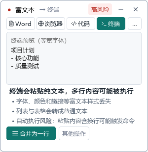

# PastePeek v2.0.0-rc.3

[简体中文](README.md) | English

[English changelog](CHANGELOG.en.md) | [中文变更日志](CHANGELOG.md)

> This is the minimum public pre-release. It has been verified on the current Windows single-monitor environment. Windows 10, real per-monitor DPI, multiple physical monitors, and clipboard writes interrupted by power loss or forced termination are not compatibility commitments for this release.

PastePeek is a lightweight Windows clipboard paste-preview tool. After you copy content, it shows the content type, the current target application, and paste risks in a small HUD near the desktop corner. Expand the HUD to compare target scenarios, inspect an approximate paste result, and optionally clean a URL, strip formatting, or merge line breaks.



The runtime defaults to Simplified Chinese and can switch to English from the HUD or tray. The English mode does not translate clipboard content or change safety rules.

## Why PastePeek

The same rich text, Markdown, code, or table can paste differently into Word, a browser, a terminal, or a chat application. PastePeek answers three questions before you paste:

- How will the target application handle this content?
- Which structures or formatting may be lost?
- Which action is appropriate for this scenario?

PastePeek does not keep clipboard history, upload content, or use an AI service.

## Features

- Recognizes rich text, plain text, structured text, and code.
- Treats standard, registered, and unknown image/file/audio formats, plus embedded HTML/RTF media, as non-text and disables destructive text conversions.
- Detects eight target application categories using foreground process names first and window classes as a fallback.
- Continues running if the foreground-window hook is unavailable and still reads the active target when new content is copied.
- Provides a `4 x 8` scenario prediction matrix with four risk levels.
- Renders approximate previews for Chrome, Markdown editors, terminals, and code editors.
- Provides structured risk summaries for Word, presentations, chat applications, and spreadsheets.
- Recommends URL cleaning, format stripping, or line merging only when the content is confirmed safe. Code, structured content, empty content, and content with an unverifiable clipboard version receive no active operation.
- Supports automatic target detection, manual override, keyboard target switching, position memory, and multi-monitor occlusion avoidance.
- Sanitizes HTML previews locally by removing images, scripts, styles, frames, objects, and event attributes.
- Runs as a portable single-file EXE with no installer.
- Supports a system tray lifecycle, HUD show/hide, and explicit exit.
- Supports optional per-user startup for the portable EXE, with silent tray residency after sign-in.

## Runtime Language

- The default language is Simplified Chinese. Choose English from the HUD `More` menu or the tray `Language` menu.
- HUD, predictions, previews, active-operation feedback, and tray text switch immediately. User clipboard text, HTML, Markdown, code, and URL parameters remain unchanged.
- The choice is stored in `%LOCALAPPDATA%\PastePeek\config.json` and restored on the next launch. Missing or invalid values fall back to Simplified Chinese.

## Download and Run

Download these files from the repository [Releases](https://github.com/1yang2471/PastePeek/releases) page:

- `PastePeek.exe`
- `PastePeek.exe.sha256`

Verify the download in PowerShell:

```powershell
$expected = (Get-Content .\PastePeek.exe.sha256).Split()[0]
$actual = (Get-FileHash .\PastePeek.exe -Algorithm SHA256).Hash.ToLowerInvariant()
$expected -eq $actual
```

Run `PastePeek.exe` only after the result is `True`. The program is portable and does not need installation. Starting it again wakes the existing instance instead of creating another tray icon or clipboard listener. Windows 10, real per-monitor DPI, and multiple physical monitors remain unverified environments.

Community builds are not signed with a commercial code-signing certificate, so Windows SmartScreen may show an unknown publisher warning. Download only from this repository's Release page and verify the SHA-256 value. Do not run a file whose hash does not match.

## Basic Usage

1. Start PastePeek.
2. Copy text, rich text, a URL, or code in any application.
3. Read the content type, target, and risk indicator in the HUD near the desktop corner.
4. Expand the HUD and select another target scenario for comparison.
5. Click a primary action only when you want PastePeek to modify the clipboard.

Keyboard actions work only when the HUD has focus:

| Key | Action |
| --- | --- |
| `Left` / `Right` | Switch target scenarios while expanded |
| `Enter` | Run the current primary action |
| `Escape` | Collapse the expanded HUD; minimize the compact HUD |

The `More` menu contains `Automatic detection`, which clears a manual target override.

## System Tray and Startup

- Click the tray icon to show or hide the HUD.
- The HUD close button hides the interface; clipboard listening continues.
- Right-click the tray icon and choose `Exit PastePeek` to end the process completely.
- The startup option is available only for the portable EXE. Source runs do not register a Python command.
- When enabled, PastePeek writes the current EXE command to the per-user Windows `Run` registry value without administrator rights and starts silently with `--background` after sign-in.
- Saved positions and tray restores are clamped to all four edges of the usable work area so taskbars do not cover the HUD.
- Moving the EXE invalidates the old startup path. Enable startup again from the new location to update it.

If the system tray is unavailable, closing the HUD exits the application instead of leaving an unreachable background process.

## Supported Targets

| Target | Common applications | Preview style |
| --- | --- | --- |
| Word | Microsoft Word, WPS Writer | Structure and formatting checklist |
| Chrome | Chrome, Edge | Sanitized local HTML |
| Code editor | VS Code, Cursor | Monospaced plain text |
| Terminal | Windows Terminal, PowerShell, cmd | Plain text with line breaks |
| Chat application | WeChat, Teams, Slack, Discord | Simplified text and risk list |
| Markdown | Typora, Obsidian | HTML converted to Markdown |
| Spreadsheet | Excel, WPS Spreadsheets | Row and column checklist |
| Presentation | PowerPoint, WPS Presentation | Outline and formatting checklist |

Target detection is heuristic. An unrecognized window uses the configured `default_target`, and you can select a target manually in the HUD.

## Privacy and Local Data

PastePeek does not need network access at runtime:

- Clipboard content is analyzed in the current process only.
- Raw clipboard content is not saved.
- The clipboard is never changed automatically; it is written only after an explicit user action.
- HTML previews do not load remote or local resources.
- `UsageTracker` is disabled by default. If you explicitly enable it, it records only the time, content type, risk level, and whether the HUD was viewed.

Local files are stored in `%LOCALAPPDATA%\PastePeek\`:

- `config.json`: position and interface preferences.
- `usage.jsonl`: optional anonymous local usage records, limited to about 1 MiB by default and rotated by replacing older batches.

Set `usage_tracking_enabled` to `true` to enable the record, or `false` to disable it. You can also delete `usage.jsonl`. See [SECURITY.en.md](SECURITY.en.md) for security reporting.

Only an explicit startup action writes the current EXE command under `HKCU\Software\Microsoft\Windows\CurrentVersion\Run` with the value name `PastePeek`. Disabling startup removes only that value.

## Run from Source

Windows 10/11 and Python 3.12 are required:

```powershell
py -3.12 -m venv .venv
.\.venv\Scripts\Activate.ps1
python -m pip install --require-hashes -r requirements.txt
python src\main.py
```

## Development and Build

```powershell
python -m pip install --require-hashes -r requirements-dev.txt
python run_tests.py
pip-compile --allow-unsafe --generate-hashes --no-emit-index-url --output-file=requirements-dev.txt --strip-extras requirements-dev.in
python -m ruff check src tests scripts build.py run_tests.py generate_icon.py render_hud_asset.py
python -m compileall -q src tests scripts build.py run_tests.py generate_icon.py render_hud_asset.py
python render_hud_asset.py
python build.py
powershell -ExecutionPolicy Bypass -File scripts/smoke_windows.ps1
powershell -ExecutionPolicy Bypass -File scripts/smoke_tray_windows.ps1
python scripts/accept_actions_windows.py
python scripts/accept_gui_windows.py
python scripts/accept_tray_windows.py
```

The build creates:

```text
dist/PastePeek.exe
dist/PastePeek.exe.sha256
dist/PastePeek-<version>-win64.zip
```

The EXE includes the Windows file and product version, product name, file description, original filename, community attribution, and copyright from `src/version.py`.

CI runs static checks, tests, compilation, dependency auditing, and a full Windows build on Python 3.12. Pushing a `v*` tag triggers the Release workflow, which revalidates the tag and creates a pre-release containing the standalone EXE, SHA-256 file, a versioned ZIP with license materials, and the license files. Builds are not code-signed, so SmartScreen may show an unknown publisher warning.

## Project Map

```text
src/
├── clipboard/     Clipboard reads
├── analyzer/      Content and structure analysis
├── detector/      Foreground target detection
├── explainer/     Scenario predictions and safe previews
├── manipulator/   User-triggered clipboard operations
├── listener/      Foreground-window change listener
├── ui/            HUD and application controllers
├── usage/         Optional local usage records
├── models/        Public data structures
├── launch_options.py  Manual and sign-in startup modes
├── single_instance.py Single-instance and wake-up IPC
├── startup.py        Per-user startup management
├── main.py           Application entry point
└── version.py        Single version source
scripts/
├── accept_actions_windows.py Real clipboard fidelity checks for the three active operations
├── accept_gui_windows.py     Full source and EXE GUI/clipboard acceptance
└── accept_tray_windows.py    Background startup and tray lifecycle UIA acceptance
render_hud_asset.py            README screenshot generation and font checks
```

## Product Boundaries

PastePeek does not provide clipboard history, cloud sync, cross-device sync, AI inference, a plugin system, or a content editor. Scenario previews are approximations and do not replace the target application's own paste behavior. Complex Office layouts, nested tables, and application-private clipboard formats still need confirmation in the target application.

See [CONTRIBUTING.en.md](CONTRIBUTING.en.md) for contributions, [SUPPORT.en.md](SUPPORT.en.md) for support, [CODE_OF_CONDUCT.en.md](CODE_OF_CONDUCT.en.md) for community standards, and [LICENSE](LICENSE) for the MIT License.
